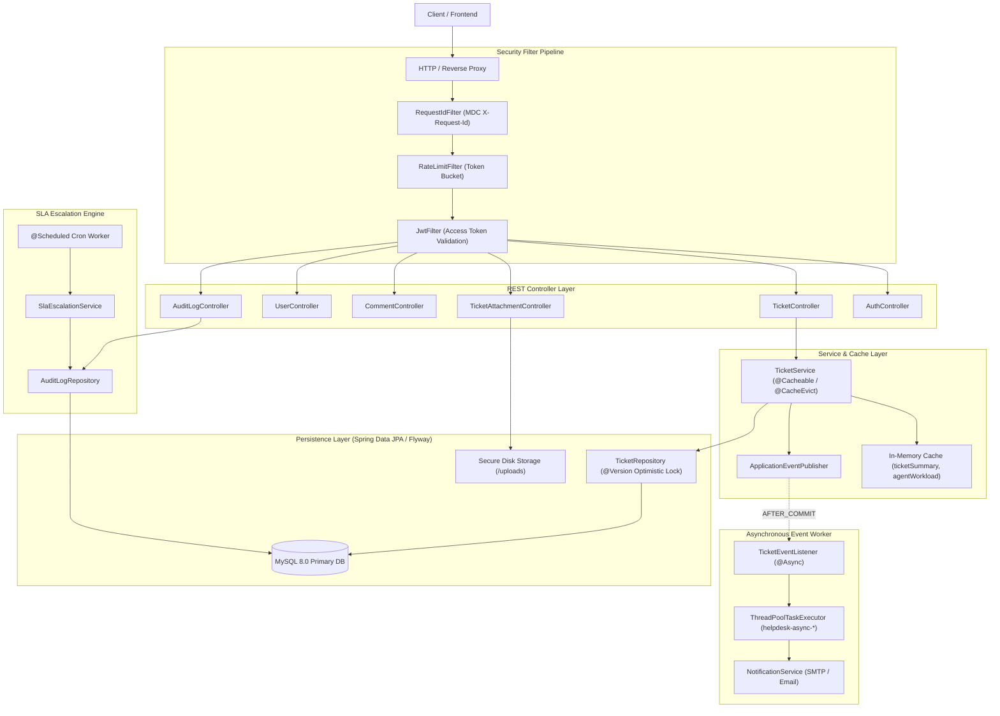

# 🎫 HelpDesk Enterprise Backend REST API

[](https://www.oracle.com/java/)
[](https://spring.io/projects/spring-boot)
[](https://spring.io/projects/spring-security)
[](https://flywaydb.org/)
[]()
[]()

A production-grade, enterprise-ready IT Operations and HelpDesk Ticket Management backend built with **Spring Boot 4**, **Java 17**, and **Spring Security**. Engineered for high reliability, concurrent workloads, real-world data isolation, and regulatory audit compliance.

---

## 🌟 Architectural Highlights



---

## 🚀 Key Production Features

### 1. 🛡️ Hardened Authentication & JWT Token Rotation
- **Zero-State JWT Authentication**: Short-lived access tokens with cryptographic HMAC signing.
- **Refresh Token Rotation & Reuse Detection**: Every refresh token issuance invalidates the prior token. If an invalidated refresh token is reused, the entire token family is immediately revoked to isolate compromised credentials.
- **Anti-Enumeration Password Recovery**: Self-service `/api/auth/forgot-password` generates single-use 15-minute cryptographic reset tokens. Responses are non-enumerable to prevent account probing. Successful reset triggers mass revocation of all active sessions.

### 2. ⚡ Concurrency Control & Optimistic Locking
- **`@Version` Optimistic Concurrency**: Ticket entities utilize database versioning to prevent lost updates when multiple agents update the same ticket simultaneously.
- **HTTP 409 Conflict Resolution**: Catches `OptimisticLockingFailureException` and returns human-readable diagnostic error payloads instructing callers to reload current state.

### 3. ⏱️ Dynamic SLA Engine & Background Escalation
- **Priority-Driven Deadlines**: Automatically calculates resolution targets upon creation (Urgent: 4 hours, High: 24 hours, Medium: 72 hours, Low: 120 hours).
- **Scheduled Escalation Worker**: An automated background job (`@Scheduled(cron = "${app.sla.check-cron}")`) continuously monitors and flags breached tickets using composite indexing (`idx_tickets_sla_breach`).
- **Audit Logging of Breaches**: Automatically appends immutable SLA breach events to the ticket audit trail.

### 4. 📬 Asynchronous Decoupled Event System
- **Transactional Domain Events**: Emits `TicketStatusChangedEvent` and `TicketAssignedEvent` upon state transitions.
- **After-Commit Execution**: Event listeners use `@TransactionalEventListener(phase = AFTER_COMMIT)` to ensure emails and side-effects are only dispatched if the database transaction commits successfully.
- **Dedicated Thread Pool**: Bound to an isolated `ThreadPoolTaskExecutor` (`helpdesk-async-*`) so external notification latency never degrades API response times.

### 5. 📎 Secure Multipart File Attachments
- **MIME Whitelisting & Size Caps**: Accepts documents and images (`application/pdf`, `image/png`, `image/jpeg`, `text/plain`) with strict 10MB request filtering.
- **Path-Traversal Prevention**: Sanitizes file paths, stores payloads using randomized UUIDs, and enforces caller authorization before streaming file resources back.

### 6. 📊 Analytical Query Caching
- **Multi-Level Metric Caching**: Highly frequent read endpoints (`/api/tickets/summary` and `/api/tickets/agent-workload`) are cached in-memory with `@Cacheable`.
- **Targeted Cache Eviction**: Every ticket creation, status update, assignment, or SLA breach immediately purges stale metrics via `@CacheEvict(allEntries = true)`.

### 7. 🔍 Enterprise Observability & Tracing
- **Correlation IDs (MDC)**: Generates or propagates `X-Request-Id` across all HTTP logs and responses.
- **Sliding-Window Rate Limiting**: In-memory token bucket per IP to protect public auth endpoints from abuse.
- **Spring Boot Actuator & Prometheus**: Metrics exposed at `/actuator/prometheus` for Grafana scraping, health checks at `/actuator/health`.
- **Audit Retention Policy**: Configurable retention window with an automated/admin-triggered cleanup job (`DELETE /api/audit/cleanup`).

---

## 📂 Project Structure

```text
helpdesk-backend/
├── docker-compose.yml                  # Multi-container production orchestrator (app, mysql, nginx, mailpit)
├── Dockerfile                          # Multi-stage container build (build & minimal non-root runtime)
├── nginx.conf                          # Upstream reverse proxy configuration
├── src/
│   ├── main/
│   │   ├── java/com/example/helpdesk_backend/
│   │   │   ├── bootstrap/              # Seed data initialization
│   │   │   ├── config/                 # Async, Cache, and OpenAPI configuration
│   │   │   ├── controller/             # REST API Controllers with Swagger annotations
│   │   │   ├── dto/                    # Request & Response Data Transfer Objects
│   │   │   ├── entity/                 # JPA Entities (Ticket, User, Attachment, Token, etc.)
│   │   │   ├── enums/                  # Status, Priority, Role enums
│   │   │   ├── event/                  # Domain Events and @Async Event Listeners
│   │   │   ├── exception/              # Global Exception Handling & Custom Errors
│   │   │   ├── repository/             # Spring Data JPA Repositories
│   │   │   ├── security/               # JWT filters, Rate limiters, MDC Tracers
│   │   │   └── service/                # Business logic, SLA worker, Attachments, Caching
│   │   └── resources/
│   │       ├── db/migration/           # Versioned Flyway SQL migrations (V1 to V6)
│   │       ├── application.properties  # Base configuration
│   │       └── application-prod.properties
│   └── test/                           # 47 Unit & Integration tests
│       └── java/com/example/helpdesk_backend/
│           ├── event/                  # Event listener tests
│           ├── integration/            # MockMvc RBAC, Auth, and Security integration tests
│           ├── security/               # JWT & Filter unit tests
│           └── service/                # Service layer, Cache, and SLA engine tests
└── pom.xml                             # Maven build dependencies
```

---

## 📑 Database Schema & Migrations

The database schema is managed via **Flyway** migrations:

| Migration | Scope | Description |
|---|---|---|
| `V1__create_initial_schema.sql` | Core Tables | Creates `users`, `tickets`, and `comments` tables. |
| `V2__create_audit_log.sql` | Security & Audit | Creates `audit_logs` table for regulatory change tracking. |
| `V3__harden_refresh_token_rotation.sql` | Token Hardening | Adds `family_id` and revoked tracking on refresh tokens for compromise isolation. |
| `V4__add_optimistic_locking_and_sla.sql` | Concurrency & SLA | Adds `@Version` column for optimistic locking, `sla_due_at`, and `sla_breached` status flags. |
| `V5__add_timestamps_and_metrics.sql` | Timestamps & Audit | Adds `created_at`, `updated_at`, `resolved_at` on tickets and `created_at` on comments. |
| `V6__workflow_features_and_soft_delete.sql` | Workflow & Soft Delete | Adds `deleted` column to tickets, `active` column to users, and `is_internal` column to comments. |

---

## 📡 REST API Reference

Interactive Swagger UI documentation is available at **`/swagger-ui.html`**.

### Authentication (`/api/auth`)
| Method | Endpoint | Access | Description |
|---|---|---|---|
| `POST` | `/api/auth/login` | Public | Authenticates user; returns JWT access & refresh tokens. |
| `POST` | `/api/auth/refresh` | Public | Rotates refresh token; issues new access token. |
| `POST` | `/api/auth/logout` | Authenticated | Revokes refresh token and ends session. |
| `POST` | `/api/auth/forgot-password` | Public | Requests single-use 15-minute password reset link. |
| `POST` | `/api/auth/reset-password` | Public | Confirms reset token and sets new password. |

### Tickets (`/api/tickets`)
| Method | Endpoint | Access | Description |
|---|---|---|---|
| `GET` | `/api/tickets` | Scoped | Retrieves tickets for current user (Customer: own, Agent: assigned, Admin: all). |
| `GET` | `/api/tickets/paged` | Scoped | Paginated and filtered search by status, priority, or title keyword. |
| `POST` | `/api/tickets` | Authenticated | Creates a new ticket and schedules dynamic SLA targets. |
| `GET` | `/api/tickets/{id}` | Scoped | Retrieves ticket details enforcing IDOR boundaries. |
| `PUT` | `/api/tickets/{id}` | Owner / Admin | Updates ticket; guarded by `@Version` optimistic locking (HTTP 409 on race). |
| `DELETE` | `/api/tickets/{id}` | Owner / Admin | Deletes ticket and associated relations. |
| `PUT` | `/api/tickets/{id}/status` | Agent / Admin | Updates ticket status along valid lifecycle path; dispatches async event. |
| `PUT` | `/api/tickets/{id}/assign` | Admin | Assigns ticket to an agent; dispatches assignment event. |
| `GET` | `/api/tickets/summary` | Admin | Cached ticket volume summary grouped by status. |
| `GET` | `/api/tickets/agent-workload` | Admin | Cached active ticket count breakdown per agent. |

### Attachments (`/api/tickets/{ticketId}/attachments`)
| Method | Endpoint | Access | Description |
|---|---|---|---|
| `POST` | `/api/tickets/{ticketId}/attachments` | Scoped | Uploads file attachment (multipart/form-data, max 10MB). |
| `GET` | `/api/tickets/{ticketId}/attachments` | Scoped | Lists all attachment metadata for a ticket. |
| `GET` | `/api/tickets/{ticketId}/attachments/{id}` | Scoped | Downloads file stream with content-disposition header. |

### Comments (`/api/tickets/{ticketId}/comments`)
| Method | Endpoint | Access | Description |
|---|---|---|---|
| `POST` | `/api/tickets/{ticketId}/comments` | Scoped | Appends a comment to a ticket. |
| `GET` | `/api/tickets/{ticketId}/comments` | Scoped | Lists chronological comments for a ticket. |

### Users & Administration (`/api/users` & `/api/audit`)
| Method | Endpoint | Access | Description |
|---|---|---|---|
| `POST` | `/api/users` | Public | Registers a new user account (`ROLE_CUSTOMER` by default). |
| `GET` | `/api/users` | Admin | Lists all user accounts. |
| `GET` | `/api/users/{id}` | Admin | Gets user details by ID. |
| `PUT` | `/api/users/{id}/role` | Admin | Updates user authority (`CUSTOMER`, `AGENT`, `ADMIN`). |
| `DELETE` | `/api/users/{id}` | Admin | Deletes user account. |
| `GET` | `/api/audit/tickets/{ticketId}` | Admin | Chronological history of ticket status and SLA changes. |
| `DELETE` | `/api/audit/cleanup` | Admin | Purges audit logs older than the retention threshold. |

---

## 🧪 Comprehensive Test Suite

The project includes **47 automated tests** spanning unit, integration, and security layers:

```bash
# Run all tests via Maven Wrapper
./mvnw clean test

# Windows Powershell
.\mvnw.cmd clean test
```

### Test Breakdown:
- **`AuthIntegrationTest`**: Complete MockMvc verification of user registration, login, token refresh rotation, and compromise isolation on token reuse.
- **`TicketSecurityIntegrationTest`**: End-to-end RBAC tests verifying IDOR protection, Customer vs Admin permission boundaries, invalid lifecycle state transitions, and comment scoping.
- **`TicketCacheTest`**: Spring Boot integration test asserting that analytical queries hit in-memory cache and are automatically evicted upon ticket state changes.
- **`SlaEscalationServiceTest`**: Verification of background breach detection, overdue computation, and audit event insertion.
- **`TicketAttachmentServiceTest`**: Tests MIME type validation, file traversal defense, and disk streaming.
- **`PasswordResetServiceTest`**: Tests single-use token lifecycle, expiration boundaries, and mass session invalidation.
- **`TicketEventListenerTest`**: Validates asynchronous event delivery on status changes and assignments.

---

## 🛠️ Local Development & Quickstart

### Prerequisites
- Java 17+ SDK
- Maven 3.8+
- MySQL 8.0 (or run via Docker)

### 1. Clone & Configure
```bash
git clone https://github.com/HarshadRawat/helpdesk-backend.git
cd helpdesk-backend/helpdesk-backend
```

### 2. Configure Environment Secrets
Create a `.env` file or export environment variables (generate a cryptographically secure 32+ character JWT secret with `openssl rand -base64 48`):
```bash
export DB_URL=jdbc:mysql://localhost:3306/helpdesk_db?useSSL=false&allowPublicKeyRetrieval=true&serverTimezone=UTC
export DB_USERNAME=root
export DB_PASSWORD=your_secure_password
export JWT_SECRET=$(openssl rand -base64 48)
export SPRING_PROFILES_ACTIVE=dev
```

### 3. Run Locally
```bash
./mvnw spring-boot:run
```
The server will start at `http://localhost:8080`.
Explore the API documentation at `http://localhost:8080/swagger-ui.html`.

---

## 🐳 Docker Deployment

The backend includes a production-ready multi-container Docker Compose configuration:

```bash
# 1. Copy environment template
cp .env.example .env

# 2. Generate and set a secure JWT secret in .env
# openssl rand -base64 48
# Note: Docker Compose enforces JWT_SECRET presence and will fail startup if left blank.

# 3. Launch production containers
docker compose up -d --build
```

Services launched:
- **`helpdesk-backend`**: Spring Boot application running on port `8080` (management actuator on `8081`).
- **`mysql`**: MySQL 8.0 server with automated initialization scripts and health probes (port `33306`).
- **`nginx`**: Reverse proxy routing requests to the application on port `18088`.
- **`mailpit`**: Mock SMTP server (`11025`) and web interface for inspecting sent notification emails at `http://localhost:18025`.

---

## ⚖️ Architectural & Production Trade-offs

This project is architected with realistic trade-offs suitable for medium-scale enterprise deployments and cleanly decouples areas for high-scale cloud migration:

1. **In-Memory Rate Limiting vs Distributed Rate Limiting**:
   - *Current Implementation*: Uses in-memory token bucket algorithms (`RateLimitFilter`) mapped per client IP, operating with reverse proxy header security (`server.forward-headers-strategy=native`). Tomcat's `RemoteIpValve` reads forwarded IPs from trusted upstream reverse proxies (including private Docker network CIDR ranges) to prevent client spoofing while ensuring distinct client buckets.
   - *Production Trade-off*: Zero external infrastructure overhead for single-instance or sticky-session deployments. In a horizontally scaled, multi-instance production cluster behind a load balancer, rate limits should be backed by a centralized distributed store like **Redis** (e.g., Bucket4j Redis integration) or enforced at the cloud API Gateway layer (AWS API Gateway, Cloudflare, Envoy).

2. **Local Disk Attachments vs Cloud Object Storage**:
   - *Current Implementation*: Ticket attachments are validated for MIME type / size and saved to a mounted persistent volume (`/app/uploads`).
   - *Production Trade-off*: Simple and isolated without external cloud IAM configurations. In a containerized Kubernetes or multi-region cluster, file storage should be abstracted to an S3-compatible object store (**Amazon S3**, **Google Cloud Storage**, or **MinIO**) using pre-signed upload/download URLs to prevent pod disk saturation.

3. **Upstream TLS / SSL Termination**:
   - *Current Implementation*: The containerized Spring Boot application runs plaintext HTTP internally (ports 8080/8081).
   - *Production Trade-off*: Enterprise standard practice terminates TLS/SSL upstream at the reverse proxy (Nginx), Kubernetes Ingress Controller, or cloud load balancer (e.g., AWS ALB / Cloudflare). The application securely reconstructs scheme, host, and client IPs using standard `X-Forwarded-*` headers handled natively by Tomcat's `RemoteIpValve`.

4. **Stateless Access Token Lifespan upon Deactivation**:
   - *Current Implementation*: Access tokens are stateless cryptographic JWTs valid for 1 hour (`app.jwt.access-expiration-ms=3600000`). When an admin deactivates a user, all active refresh tokens are immediately revoked and further logins are blocked. However, an already issued, unexpired stateless access token remains cryptographically valid until its 1-hour expiration.
   - *Production Trade-off*: Eliminates database or cache lookup overhead on every authenticated request (pure CPU verification). In environments requiring instantaneous sub-second revocation of access tokens across all active requests, a distributed token blocklist (e.g., Redis blacklisting with TTL matching token expiry) or an active user status cache check in `JwtFilter` can be enabled.

---

## 📜 Production Readiness Checklist

- [x] **Stateless Security**: JWT tokens with refresh rotation and reuse prevention.
- [x] **Data Isolation**: Role-based access control protecting against Insecure Direct Object References (IDOR).
- [x] **Concurrency Safety**: Optimistic locking preventing lost updates under concurrent access.
- [x] **Decoupled Architecture**: Asynchronous transactional event listener with isolated thread pool.
- [x] **Service Level Agreements**: Automated background escalation engine with composite DB indexing.
- [x] **Performance Optimization**: In-memory caching for expensive analytical aggregates with automatic eviction.
- [x] **File Safety**: MIME whitelist enforcement, file-size guards, and sanitized disk storage.
- [x] **Observability**: Prometheus metrics export, structured MDC request correlation, and audit logging.
- [x] **Automated Testing**: Comprehensive test suite covering unit, MockMvc security, caching, MySQL migrations, and domain logic.
- [x] **Interactive Documentation**: OpenAPI 3.0 / Swagger UI integration with JWT Bearer support.
